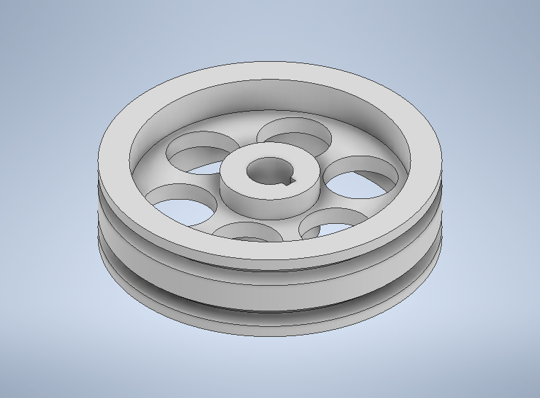
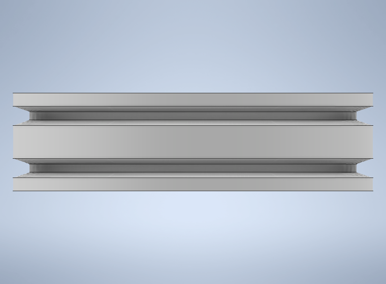

# inventor-mcp for DSH

把 **Autodesk Inventor** 接进 DeepSeek Harness（DSH）的 MCP bundle。装上之后，DSH 里的 agent 可以直接打开 Inventor、画草图、拉伸/旋转/开孔、装配、出工程图 PDF、导 STEP，并且**能自己截图看结果**。

> An MCP bundle that connects Autodesk Inventor to DSH agents — 66 tools, stdio transport, works on a running Inventor instance.




> 上图是一个 agent 用本 bundle 建的参数化 V 带轮：16 个用户参数、3 个全约束草图（状态码 51713），
> 改 `groove_angle` 或 `rim_od` 后体积在 110716.6 / 111850.9 / 163565.0 mm³ 之间精确复现。

---

## 它做什么

| 能力 | 说明 |
|---|---|
| 参数化建模 | 建用户参数（`rim_od = 110 mm`），草图尺寸全用表达式驱动 |
| 零件/钣金/装配 | 回转体、拉伸切除、圆角倒角、钣金展开、约束装配 |
| 自己验收 | `capture_view` 把模型渲染成图片回给模型；`inspect_model` 报体积/包围盒/面数 |
| 出图交付 | `create_drawing` 直接出 PDF 工程图；`export_step` / `export_flat_pattern` 出 DXF |
| 标准件 | 浏览 Content Center、按规格生成螺栓/型钢 |

工具清单见 [docs/DETAIL.md](docs/DETAIL.md) 和 [docs/TOOLS.md](docs/TOOLS.md)。

## 前置条件

- Windows（Inventor 只有 Windows 版）
- Autodesk Inventor 2019 或更高（开发与实测于 **Inventor 2025**，中文版、GB 标准、毫米单位）
- Python **3.12+**（`inventor-mcp-server` 要求）
- DSH（本 bundle 通过 `@deepseek-ai/dsh-mcp-client` 接入）
- Inventor 至少要启动过一次（首次启动完成许可证激活）

## 安装

```powershell
# 1. 装依赖
pip install --upgrade inventor-mcp-server pywin32

# 2. 在本仓库目录下运行安装脚本（必须：它把 python 写成绝对路径，并把启动器路径写进 args）
.\install.ps1

# 3. 注册到 DSH（在 DSH 会话里让 agent 执行，或手动运行）
#    plugin_manager install_bundle <本仓库绝对路径>
```

装好后在 DSH 会话里：

```
connect()            # 连上正在运行的 Inventor（没有就启动一个）
```

`list_instances` 可以看当前连了几个 Inventor、各自开着什么文档。

## 快速开始

```python
connect()
create_document(kind="part", name="法兰", material="Steel, Mild")
create_sketch("XY")
draw_closed_profile([[0,0],[60,0],[60,10],[40,10],[40,40],[0,40]])
revolve(axis="Y", angle=360, operation="join")
inspect_model()                 # 体积、包围盒、特征树
capture_view(views="iso")       # 渲染成图片，模型自己看
save_document(path="D:/parts/flange.ipt")
```

## 与上游的关系

本仓库**不包含**建模引擎的源码，它是一个 DSH 侧的接入层：

- 建模工具本体：[`inventor-mcp-server`](https://pypi.org/project/inventor-mcp-server/)（MIT，作者 inventor-mcp contributors，上游 [cenitu/inventor-mcp-server](https://github.com/cenitu/inventor-mcp-server)）
- 本仓库负责：`cordis.patch.yml`（DSH 侧 MCP client 配置）、`package.json`（bundle 声明）、`run_inventor_mcp.py`（启动器：自动选择 pip 包或离线运行时）、`install.ps1`、文档

## 启动器如何选择后端

`install.ps1` 会把 `cordis.patch.yml` 的 args 指向 `run_inventor_mcp.py`。这个启动器启动时按顺序尝试：

1. **pip 包**：`import inventor_mcp_server` 成功 → 直接运行（推荐路径）
2. **离线运行时**：失败则扫 `runtime/ext/*/inventor_mcp_server/server.py` → 用 `runpy` 运行
3. 两者都没有 → 打印清晰错误并退出

所以 `pip install inventor-mcp-server` 是唯一必须的依赖步骤；`runtime/` 只是给没有外网或 pip 受限的机器准备的备选（本仓库不提交，见 `.gitignore`）。

## 验证

```powershell
python tests\smoke.py
```

不需要 Inventor 在跑。会检查 Python 版本、模块能否导入、MCP stdio 握手是否返回 66 个工具、
配置文件结构、以及仓库里是否残留个人绝对路径。CI 在 Python 3.12/3.13/3.14 上跑同一套。

## 已知限制

- **会话隔离**：MCP server 必须由 DSH 主进程启动，才能跨进程 COM 连上桌面会话里的 Inventor。如果你在沙盒化的 shell 里直接 `Dispatch("Inventor.Application")`，会得到 `0x80080005`。
- **首次连接**：若 Inventor 是手工打开的，可能要先 `connect()` 一次；多个实例用 `list_instances` + `instance=` 区分。
- 只支持 Windows + 已授权的 Inventor。
- 单位：MCP 层全部是 **mm**；底层 COM 是 cm，转换在包内完成。

## License

MIT，见 [LICENSE](LICENSE)。

上游 `inventor-mcp-server` 同为 MIT，版权归其作者；本项目仅提供 DSH 集成层。
